*Includes [Font Awesome Free](https://fontawesome.com) icons by Fonticons, Inc. ([CC BY 4.0](https://creativecommons.org/licenses/by/4.0/)) and the [TeX Gyre Heros](https://www.gust.org.pl/projects/e-foundry/tex-gyre/heros) font by B. Jackowski and J.M. Nowacki for GUST ([GUST Font License](http://www.gust.org.pl/fonts/licenses/GUST-FONT-LICENSE.txt)); see [NOTICE](NOTICE) and [LICENSES](LICENSES/).*

# Mermaid Diagram Compiler (rust)

I built this after having issues with the way that mermaid works in terms of the attack surface, memory footprint, etc. I heard that they use puppeteer because it allows them to take advantage of the Blink layout engine in Chrome(ium). I figured that there were some rust crates that could do layouts, I had remembered seeing them when working on another project. So, I found taffy and I pointed my agent at the Mermaid source code and told it to use that and implement as much as possible.

In the following days, I set up an agent loop that launches sub-agents and continues until the output diagrams match from both programs. So far, it has gotten pretty close to compatible in most cases. If you find anything that is incompatible, please feel free to leave an issue or open a pull request. I will do my best to review them in a timely manner.

This project comes with no warranty, and if you would like to use it in your project,
it is under the CC0 license in the public domain. Attribution is appreciated,
but not required.

Inquiries: `sam@robog.net`.


[I used Claude Code with Opus 5.5 to develop all of the code in this project.](https://robog.net/docs/generative-ai-usage)

---

**Examples of diagrams generated with this tool:**

<table>
  <tr>
    <td align="center" width="25%"><a href="docs/gallery/flowchart.svg">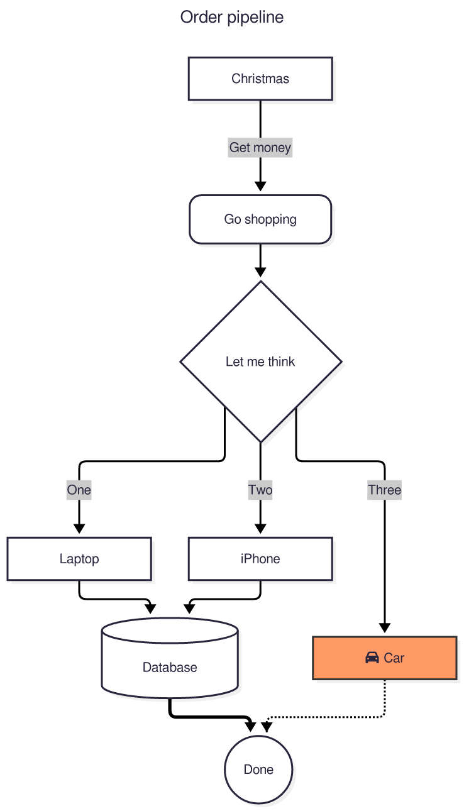</a><br><sub>Flowchart</sub></td>
    <td align="center" width="25%"><a href="docs/gallery/sequence.svg">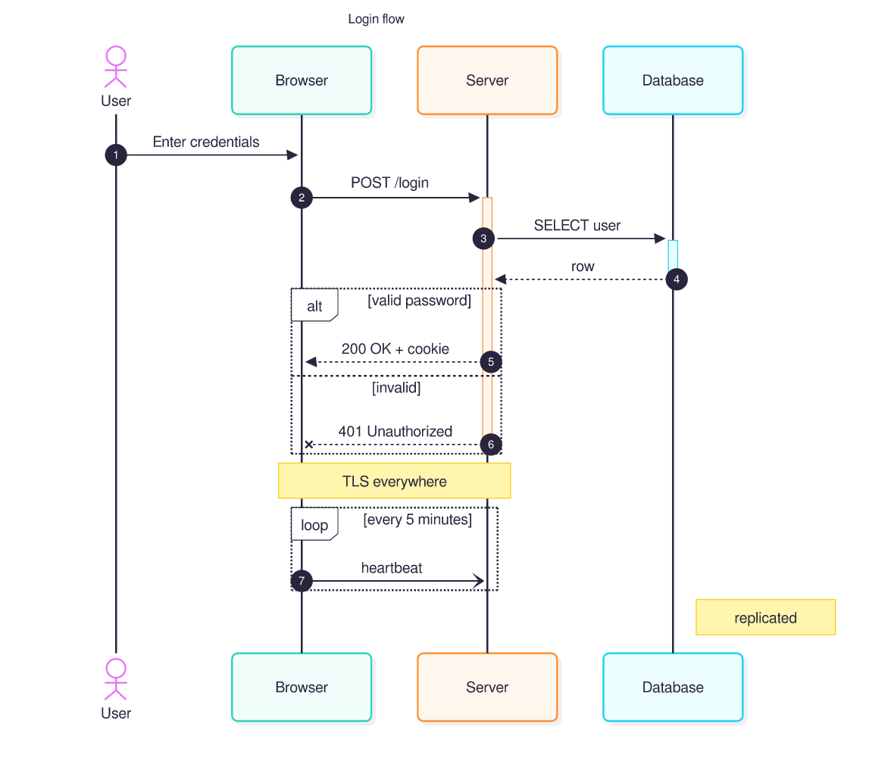</a><br><sub>Sequence</sub></td>
    <td align="center" width="25%"><a href="docs/gallery/class.svg">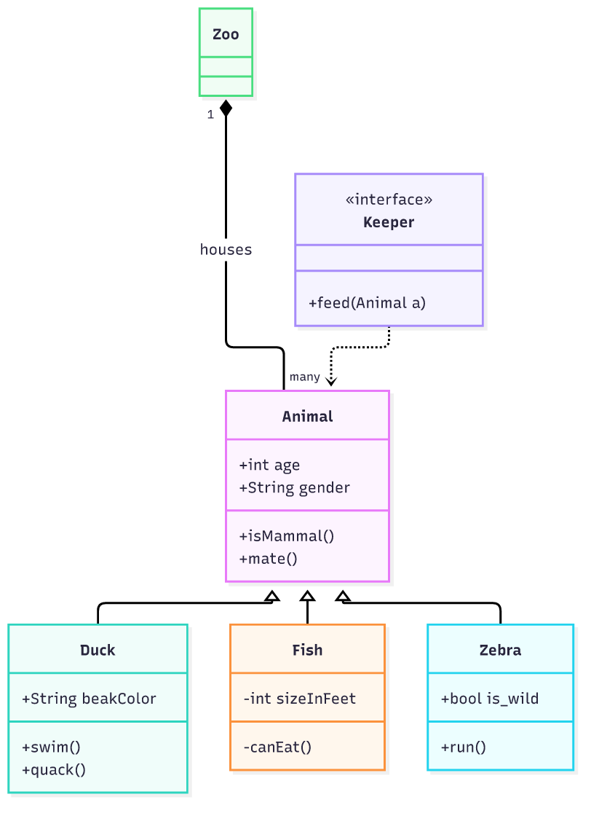</a><br><sub>Class</sub></td>
    <td align="center" width="25%"><a href="docs/gallery/state.svg">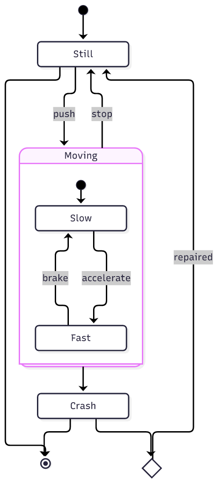</a><br><sub>State</sub></td>
  </tr>
  <tr>
    <td align="center" width="25%"><a href="docs/gallery/er.svg">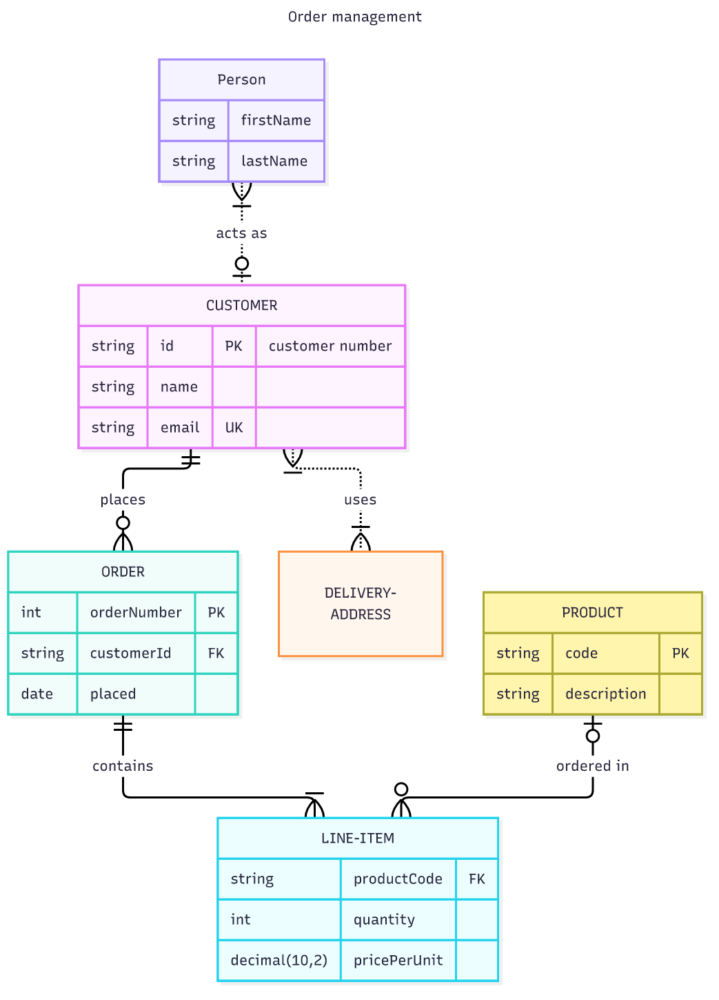</a><br><sub>ER</sub></td>
    <td align="center" width="25%"><a href="docs/gallery/gantt.svg">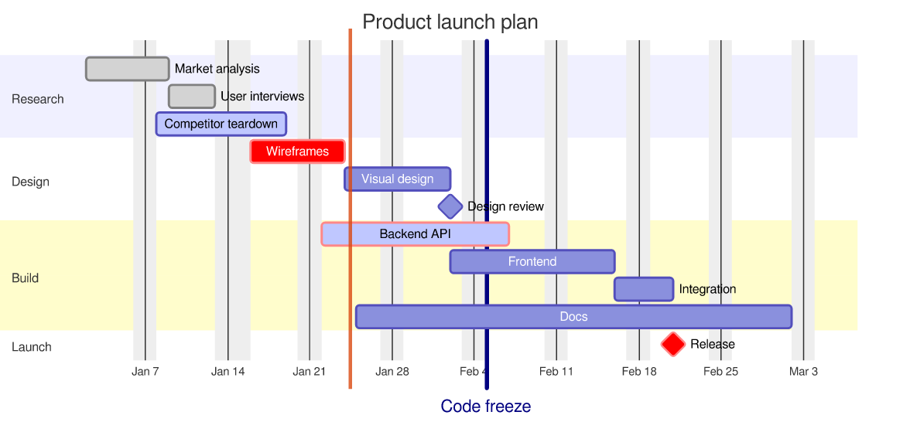</a><br><sub>Gantt</sub></td>
    <td align="center" width="25%"><a href="docs/gallery/mindmap.svg">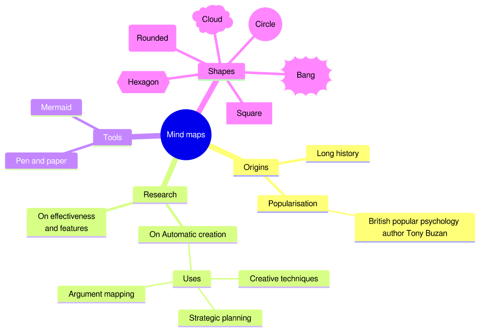</a><br><sub>Mindmap</sub></td>
    <td align="center" width="25%"><a href="docs/gallery/gitgraph.svg">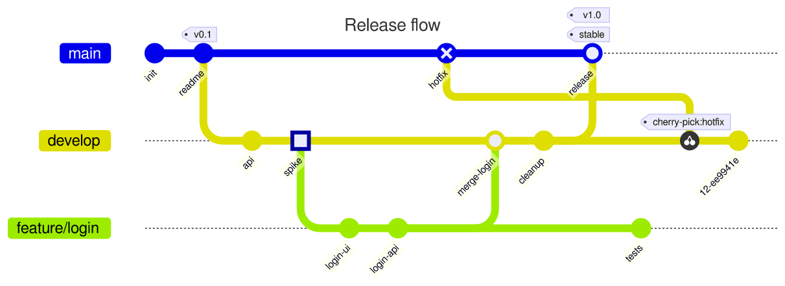</a><br><sub>Git graph</sub></td>
  </tr>
  <tr>
    <td align="center" width="25%"><a href="docs/gallery/pie.svg">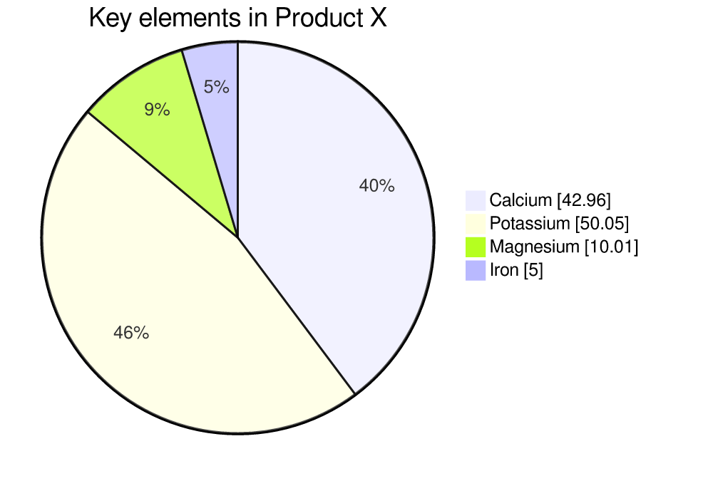</a><br><sub>Pie</sub></td>
    <td align="center" width="25%"><a href="docs/gallery/sankey.svg">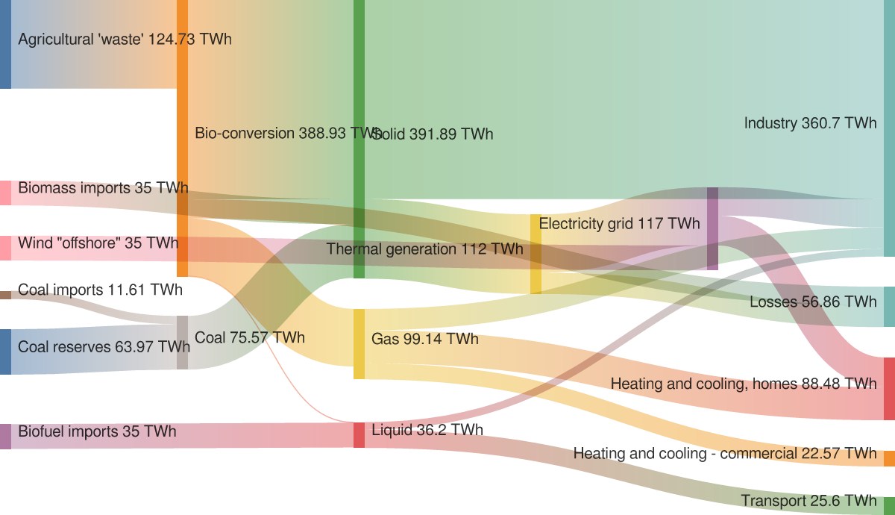</a><br><sub>Sankey</sub></td>
    <td align="center" width="25%"><a href="docs/gallery/xychart.svg">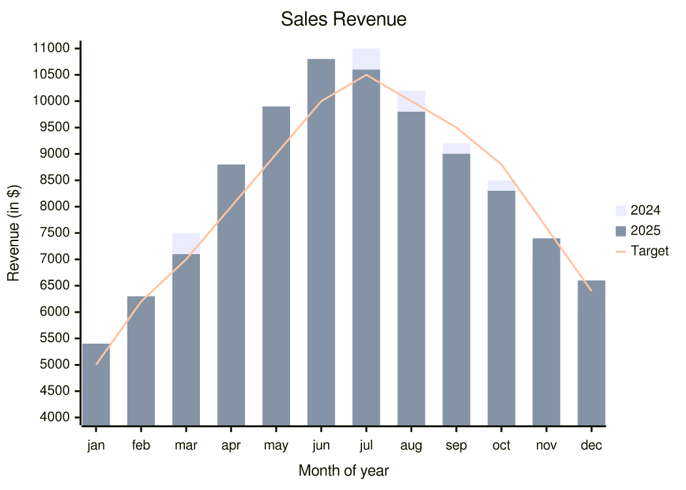</a><br><sub>XY chart</sub></td>
    <td align="center" width="25%"><a href="docs/gallery/architecture.svg">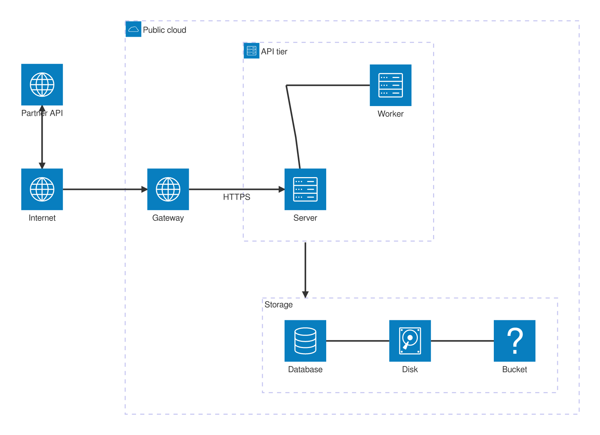</a><br><sub>Architecture</sub></td>
  </tr>
</table>

These are from the list of examples generated by the LLM to verify compatibility. You can take a peek at the whole list here: [docs/GALLERY.md](docs/GALLERY.md).

## Icon packs and images

`mmdc` takes mermaid-cli 12's icon pack options and registers the packs with
the renderer, so `logos:aws`-style icons draw wherever mermaid draws registered
icons: flowchart icon nodes (`A@{ icon: "logos:aws", form: "circle" }`),
architecture services and groups (`service db(logos:aws)[DB]`), treeView
`icon(...)` annotations and usecase icon actors.

```sh
# An installed Iconify package (npm install @iconify-json/logos), registered
# under the `prefix` in its icons.json:
mmdc -i in.mmd -o out.svg --iconPacks @iconify-json/logos

# A pack by name and URL: a file:// URL, a local path, or http(s)://
mmdc -i in.mmd -o out.png \
  --iconPacksNamesAndUrls azure#file:///path/to/azure-icons.json \
  --iconPacksNamesAndUrls mine#./my-icons.json
```

- The packs are [Iconify JSON](https://iconify.design/docs/types/iconify-json.html)
  icon sets: set-wide `width` / `height` defaults, per-icon `left` / `top`,
  aliases (with their `hFlip`, `vFlip` and `rotate`) and `id`s are handled as
  mermaid's `@iconify/utils` handles them.
- `--iconPacks <package>` looks for `node_modules/<package>/icons.json` in the
  working directory and its parents, as Node resolves an installed package.
  When it is not installed, it fetches `https://unpkg.com/<package>/icons.json`
  (mermaid-cli 12 only uses installed packages); a package found nowhere, or
  whose JSON has no `prefix`, is an error, as in mmdc.
- `--iconPacksNamesAndUrls` also accepts a plain path (mmdc wants a URL). A
  pack that cannot be loaded is a warning, and its icons draw mermaid's
  unknown-icon placeholder, as in mmdc.
- An icon is written as mermaid writes it, an inline `<svg>` positioned by
  what it draws. Its gradient and clip `id`s are renamed as Iconify's
  `replaceIDs` renames them, with a deterministic prefix instead of
  mermaid's random one. An HTML label's `fa:fa-…` reference stays a Font
  Awesome glyph, even when a pack named `fa` is registered (mermaid draws
  that pack's icon there).

Image nodes (`A@{ img: "…" }`) draw in SVG, PNG and PDF output. `data:` URIs
(PNG, JPEG, GIF, WebP or SVG) are used as they are. A remote image (`https:` or
`http:`, or a `file:` URL or absolute path) is fetched before rendering, as
mermaid's browser fetches it: its bytes give its natural size, PNG and PDF
output draw them, and the SVG keeps the link. One that cannot be fetched fails
with mermaid's `The source image cannot be decoded.`, as mmdc does without
network.

HTTP(S) is fetched by running `curl` (it must be on `PATH`); the binary has no
HTTP or TLS stack of its own, and the library never does I/O. In PDF output a
JPEG is embedded as it is, other images as Flate-compressed RGB with an alpha
mask, and SVG images and icons as raster images at 4 samples per pixel. A build
without the `png` feature embeds only JPEGs.
