# Mermaid Diagram Compiler (rust)

I built this after having issues with the way that mermaid works in terms of the attack surface, memory footprint, etc. I heard that they use puppeteer because it allows them to take advantage of the Blink layout engine in Chrome(ium). I figured that there were some rust crates that could do layouts, I had remembered seeing them when working on another project. So, I found taffy and I pointed my agent at the Mermaid source code and told it to use that and implement as much as possible.

In the following days, I set up an agent loop that launches sub-agents and continues until the output diagrams match from both programs. So far, it has gotten pretty close to compatible in most cases. If you find anything that is incompatible, please feel free to leave an issue or open a pull request. I will do my best to review them in a timely manner.

This project comes with no warranty, and if you would like to use it in your project,
it is under the CC0 license in the public domain. Attribution is appreciated,
but not required.

Inquiries: `sam@robog.net`.

[I used Claude Code with Opus 5.5 to develop all of the code in this project.](https://robog.net/docs/generative-ai-usage)

---

**Examples of diagrams generated with this tool:**

<table>
  <tr>
    <td align="center" width="25%"><a href="docs/gallery/flowchart.svg">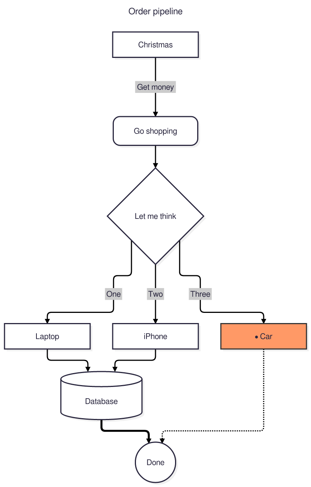</a> Flowchart</td>
    <td align="center" width="25%"><a href="docs/gallery/sequence.svg">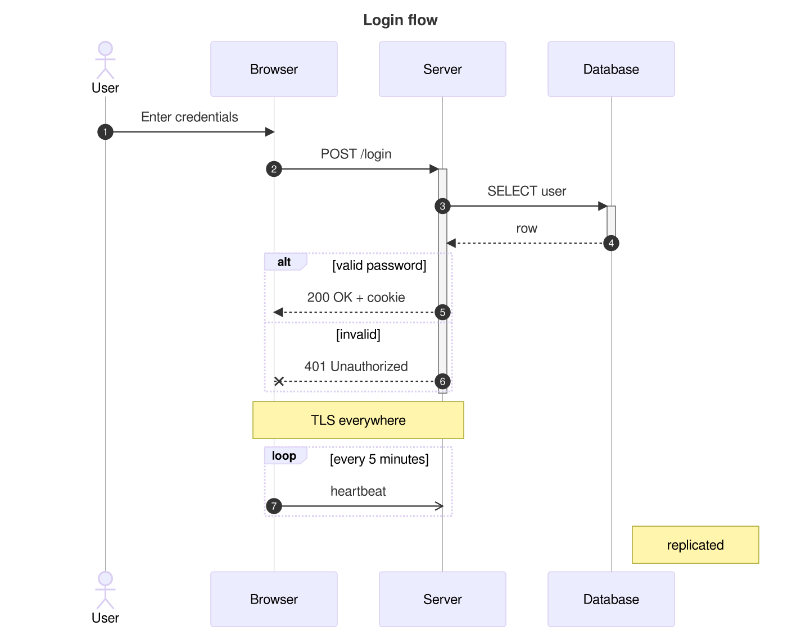</a> Sequence</td>
    <td align="center" width="25%"><a href="docs/gallery/class.svg">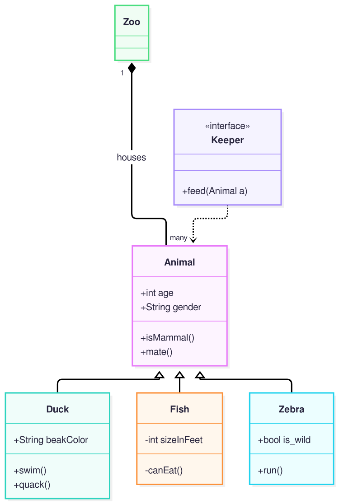</a> Class</td>
    <td align="center" width="25%"><a href="docs/gallery/state.svg">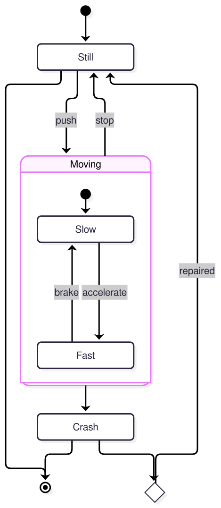</a> State</td>
  </tr>
  <tr>
    <td align="center" width="25%"><a href="docs/gallery/er.svg">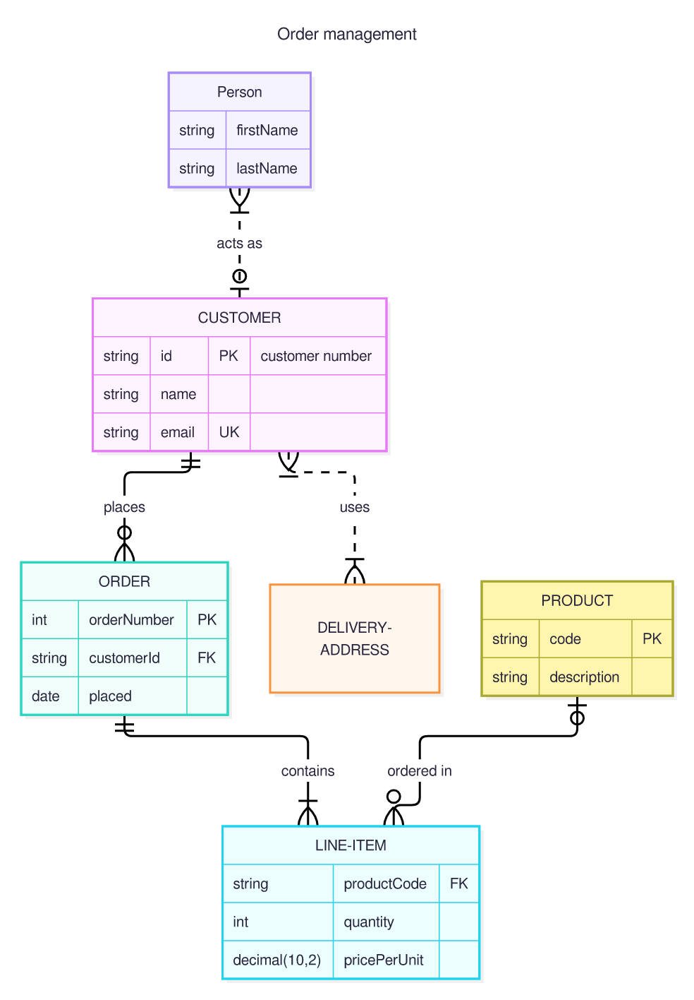</a> ER</td>
    <td align="center" width="25%"><a href="docs/gallery/gantt.svg">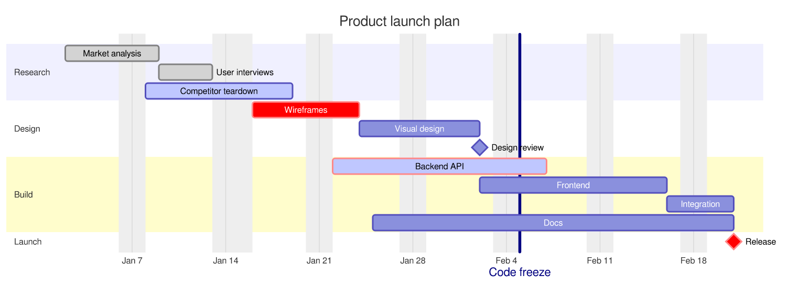</a> Gantt</td>
    <td align="center" width="25%"><a href="docs/gallery/mindmap.svg">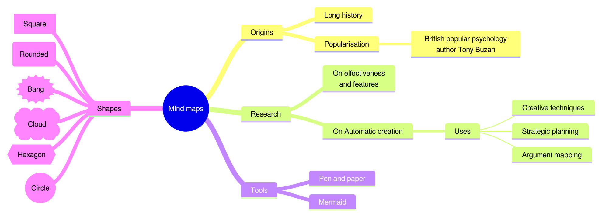</a> Mindmap</td>
    <td align="center" width="25%"><a href="docs/gallery/gitgraph.svg">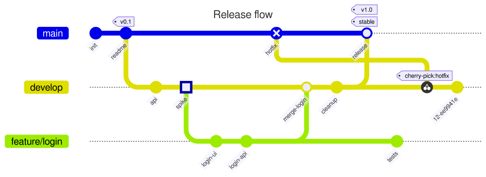</a> Git graph</td>
  </tr>
  <tr>
    <td align="center" width="25%"><a href="docs/gallery/pie.svg">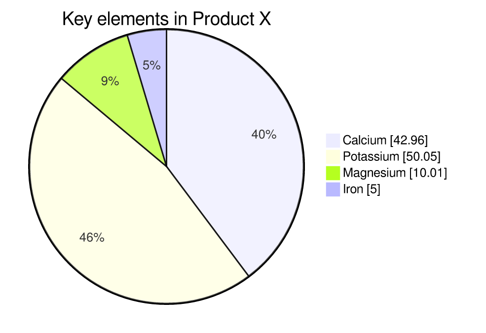</a> Pie</td>
    <td align="center" width="25%"><a href="docs/gallery/sankey.svg">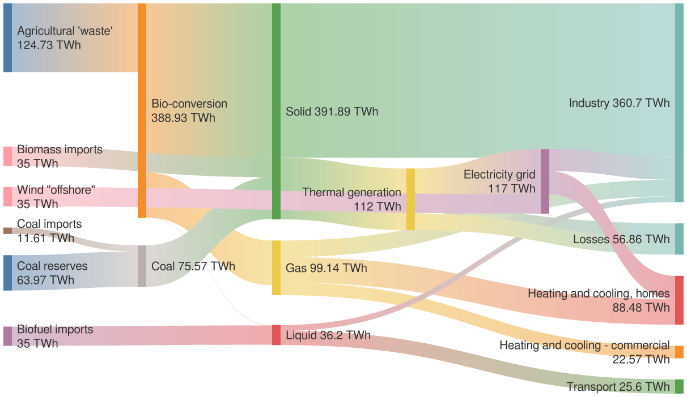</a> Sankey</td>
    <td align="center" width="25%"><a href="docs/gallery/xychart.svg">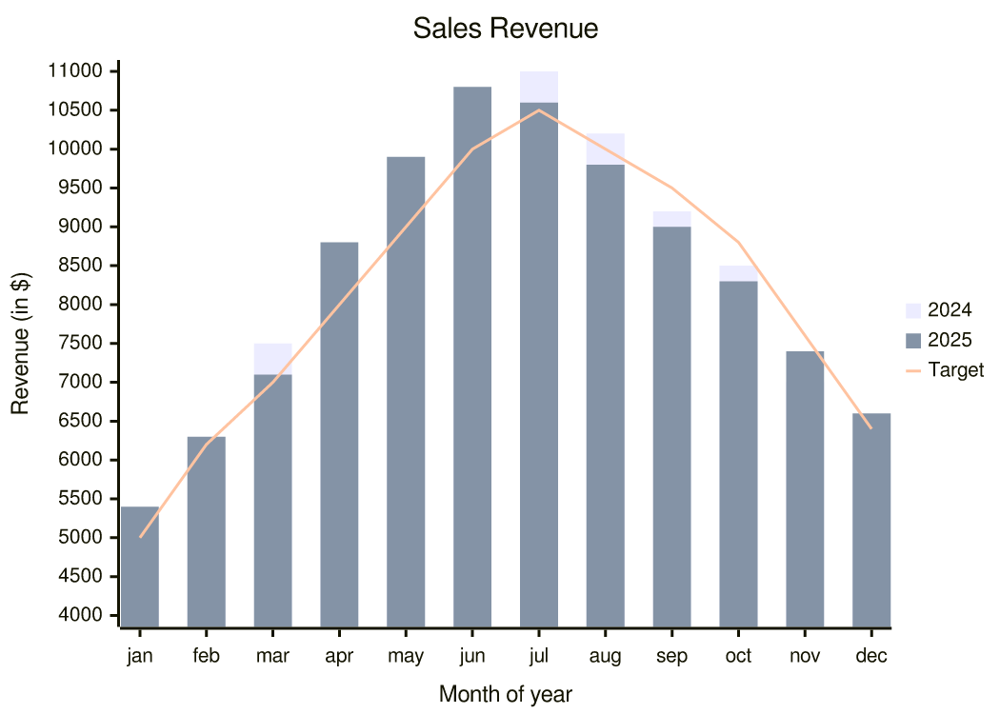</a> XY chart</td>
    <td align="center" width="25%"><a href="docs/gallery/architecture.svg">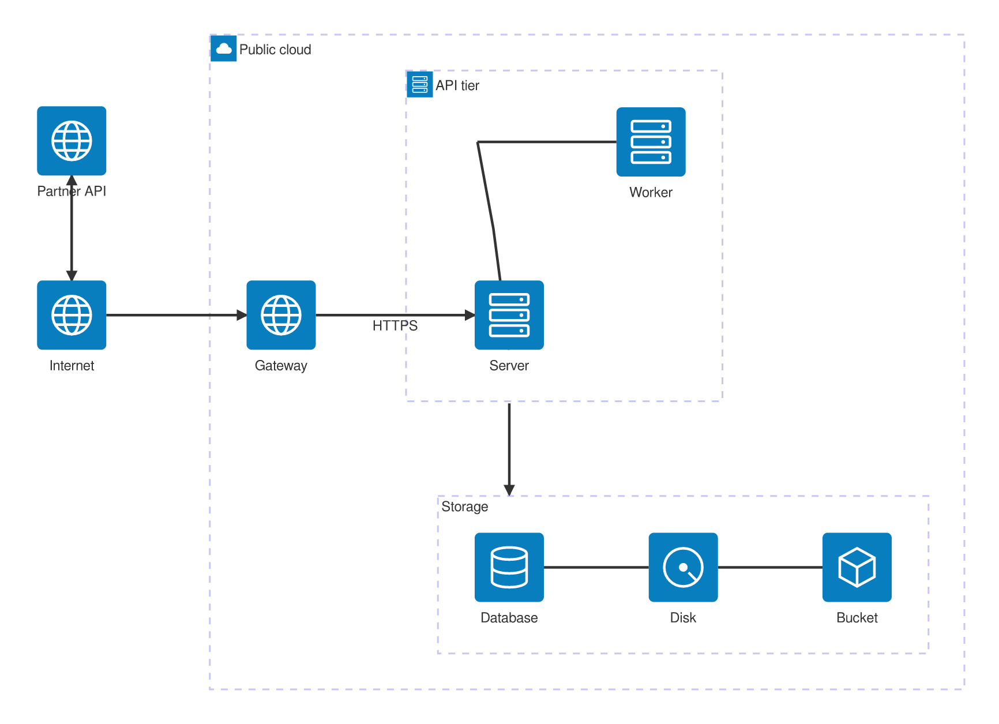</a> Architecture</td>
  </tr>
</table>

These are from the list of examples generated by the LLM to verify compatibility. You can take a peek at the whole list here: [docs/GALLERY.md](docs/GALLERY.md).
