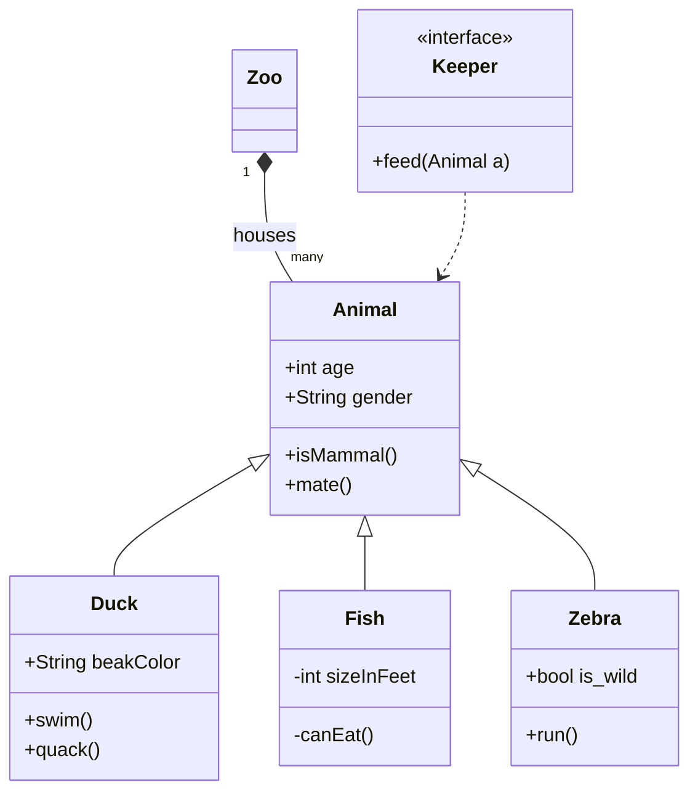
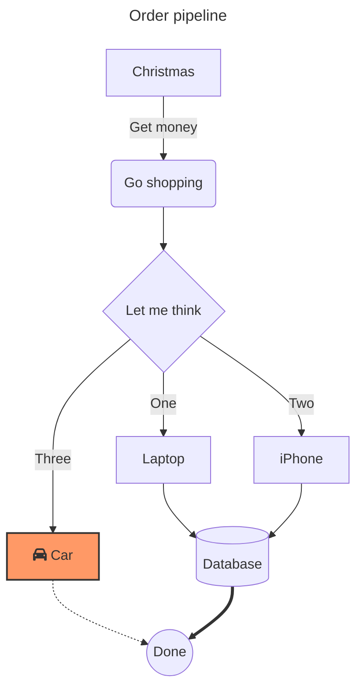
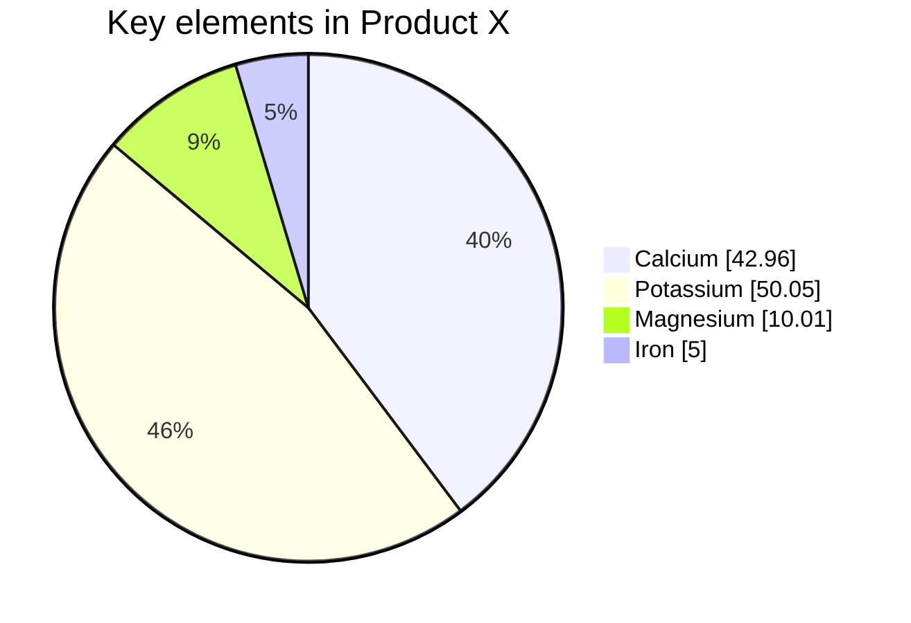
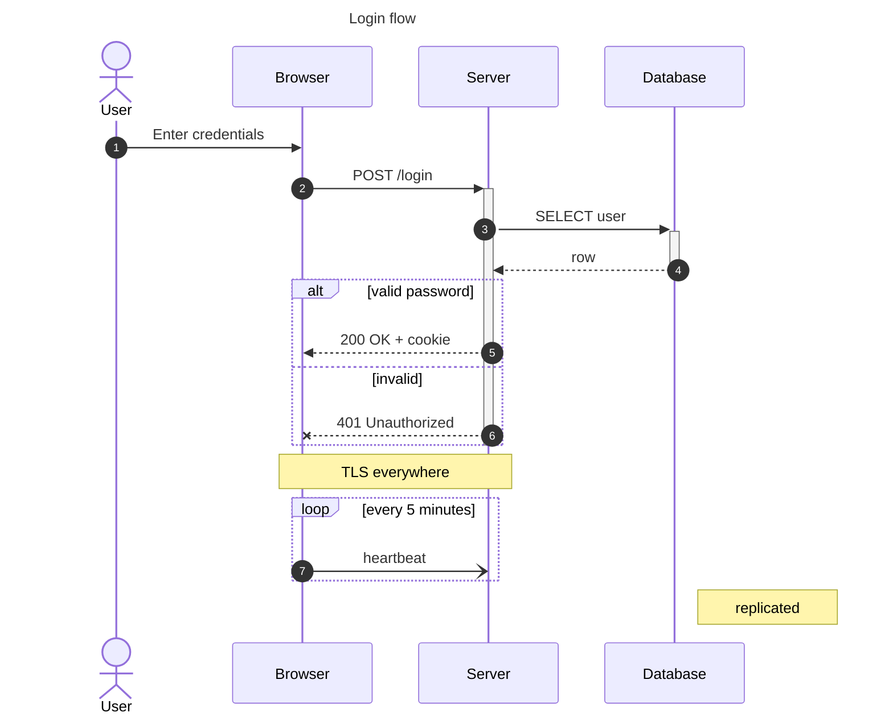
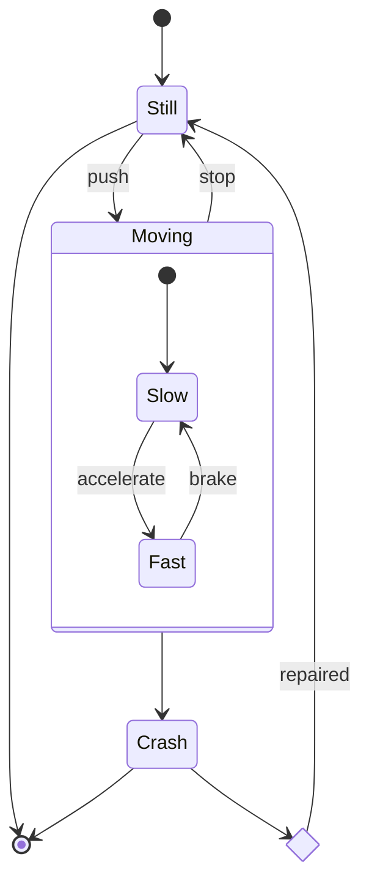
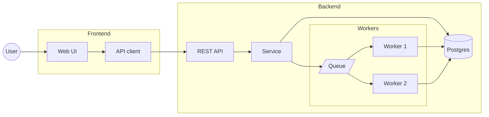

# Gallery

Every example in `examples/diagrams/`, rendered by this implementation (no browser).
Regenerate with `cargo run --release --example gallery`.

## class

Source: [`examples/diagrams/class.mmd`](../examples/diagrams/class.mmd) · rendered in 195.80µs

source

## flowchart

Source: [`examples/diagrams/flowchart.mmd`](../examples/diagrams/flowchart.mmd) · rendered in 119.30µs

source

## pie

Source: [`examples/diagrams/pie.mmd`](../examples/diagrams/pie.mmd) · rendered in 35.16µs

source

## sequence

Source: [`examples/diagrams/sequence.mmd`](../examples/diagrams/sequence.mmd) · rendered in 72.73µs

source

## state

Source: [`examples/diagrams/state.mmd`](../examples/diagrams/state.mmd) · rendered in 148.50µs

source

## subgraphs

Source: [`examples/diagrams/subgraphs.mmd`](../examples/diagrams/subgraphs.mmd) · rendered in 120.90µs

source

